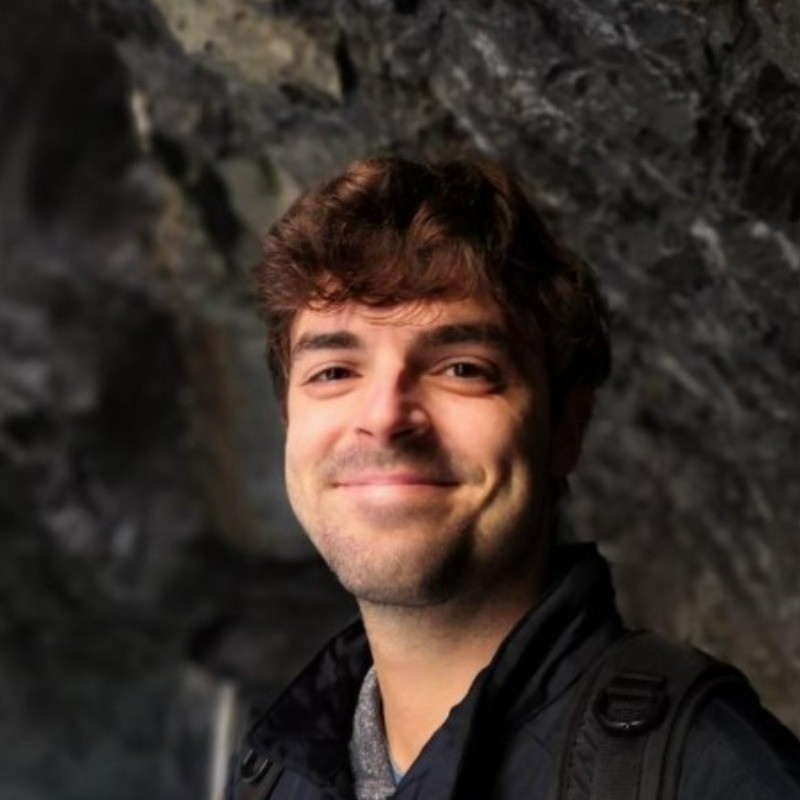

# Stefan Dvoretskii

<a href="stefan.dvorezky@gmail.com">Email: stefan.dvorezky@gmail.com</a> 
   
  Phone: +4915208663081
   
<a href="https://www.linkedin.com/in/stefan-dvoretskii/">LinkedIn: https://www.linkedin.com/in/stefan-dvoretskii/</a>
    
  <a href="https://github.com/stefanches7">GitHub: stefanches7</a>
 

 
### Skills

Neuroengineering, Biofabrication, Computational Biology, Dynamical Systems, Science Communication, International Collaboration

## Work experience

`12.2025-currently`
__Neuroengineer | Eightsix Science, Utrecht, Netherlands__ 
- Leading a **biotech lab** on an incubator base to fabricate neural regenerative implants for glioma, stroke and traumatic injury
- Working with **AI models** to support biofabrication
- **Leading a working package** of the awarded **EIC Pathfinder** grant

`12.2023-12.2025`
__Research Data Architect | German Cancer Research   Center, Heidelberg, Germany__ 
- Researched AI model usage for Biomedical metadata curation, drastically offseting costs
- Received a **Field Study** grant of 30,000€ to study AI metadata curation in German clinics 

`09.04.2021-31.07.2021`
__Application Engineer | Mentalab, Munich, Germany__ 
- Developed 2 use-cases for company's BCI interface

`01.10.2020-31.03.2021`
__Working Student IT | STABL GmbH, Munich, Germany__ 
- Implemented a telemetric control of the multimodal battery rack

`05.2019-08.2019`
__Google Summer of Code '19 Student | International Neuroinformatics Coordination Facility (Dr. Bradly Alicea), Sweden__ 
- Produced an embodied cognitive simulation, which resulted in a MIT Artificial Life publication and 4 workshop presentations

`05.2017-08.2017`
__Google Summer of Code '17 Student | European Bioinformatics Institute, EMBL, Cambridge, UK__ 
- Developed a search API with a web interface (Javascript, React.js, Perl, HTML/CSS) which saves file search time by 153%

`01.2017-08.2017`	 
__Student Developer | Omikron Data Quality GmbH, Berlin, Germany__ 
- Assisted with small software development tasks in a web inventory application used by OBI and other big retailers

`10.2016-11.2016`	
__Junior Project Manager | Deutsche Payment GmbH (Berlin) and Upnext Technologies Sp. z o.o. (Warsaw), Germany__ 
- Managed a cross-country software development collaboration of an active payment gateway

## Education

`12.2025-ongoing`
__PhD Regenerative Medicine__, __UMC Utrecht / University Utrecht__
- • Thesis topic: Generative Context-Aware Biofabrication of Implantable Neural Tissue
- • Supervisors: Daniel Burger (CEO Eightsix Science), Dr. Kentaroh Takagaki (Yamanashi University, Japan), Dr. Riccardo Levato (University of Utrecht / UMC Utrecht)

`10.2020-09.2023`
__Elite M. Sc. Neuroengineering__ in Elite Network of Bavaria,  __TU Munich, Germany__
- • Average grade: __2,2__ (best – 1,0; worst – 5,0)
- • Thesis: SNN model of in vitro 2D neuronal networks, saving up to €6,000 per experiment through computer simulation. DOI:10.5281/zenodo.14441659
- • _Stays abroad_: HKUST, Hong Kong (Aug 2022 - Jan 2023); DTU, Denmark (Jan 2023 - June 2023); Uni Barcelona (June 2023 - Oct 2023)

`10.2017-09.2020`
__B.Sc. Bioinformatics__ at the TU Munich/LMU Munich   (joint study program), Germany
- • Average grade: __1,9__ (best – 1,0; worst – 5,0)
- • Thesis: SARS-CoV-2 variants in RNASeq data, facilitating the investigation of communal infection in hospitals. DOI:10.5281/zenodo.18010516

## Fellowships

`Fellowship`
__Hans-Rudolf__-Stiftung, 10.2018-10.2023 - 10500€

`Fellowship`	
__BayBIDS__ motivation stipend, 11.2017-10.2018 - 3300€

`Fellowship`	
Motivation stipend of the __TU Berlin__, 09.2016 - 07.2017 - 3000€

`Mobility`
__Erasmus+__ SMP, June 2023-Oct 2023 - University of Barcelona, Spain - ca. 3000€

`Mobility`
__Erasmus+__ mobility, Spring 2023 - Technical University of Denmark, Copenhagen - ca. 4000€

`Mobility`
Hong Kong University of Science and Technology, Fall 2022 - 2000€

## Skills and Hobbies 

### Languages 

German (fluent), English (fluent), Latin (GOLD ELEX), Ancient Greek (BRONZE ELEX), Russian (mother tongue), Ukrainian (mother tongue), Chinese (A2.1), Danish (beginner), Bulgarian (beginner)

### Music instruments

Violin (good), piano, ukulele, domra, guitar (bearable)

### Hobbys

Reading, Philosophy, Psychology, Basketball, Programming, listening to music, riding a bike, walking

_Last updated: November 2026_
